# briskd

[](https://github.com/egorsmkv/briskd/actions/workflows/ci.yml)

An IRC server written in Erlang/OTP, with TCP, TLS, and WebSocket listeners,
Mnesia-backed state, and server links that carry bursts, multi-hop routing,
and netsplit cleanup.

This is an implementation of the RFC 1459 and RFC 2810–2813 behavior listed in
the [roadmap](ROADMAP.md), plus the IRCv3 specifications on
<https://ircv3.net/irc/>.

## WebIRC

The development container serves the browser client at
<http://127.0.0.1:8081/>. These are that client on DevNet, in the light and
dark themes. How to use it is in [WebIRC](docs/webirc.md).

| View | Light | Dark |
| --- | --- | --- |
| Connect | 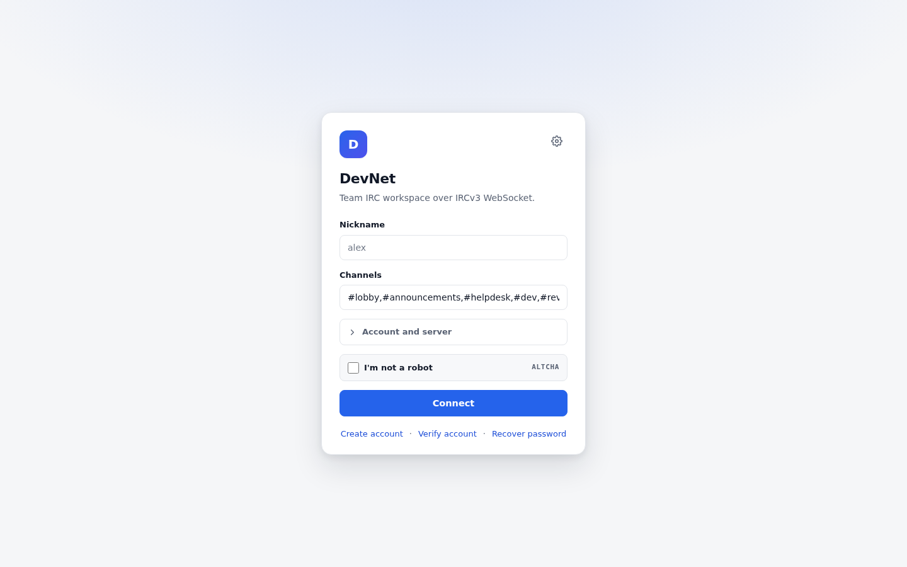 | 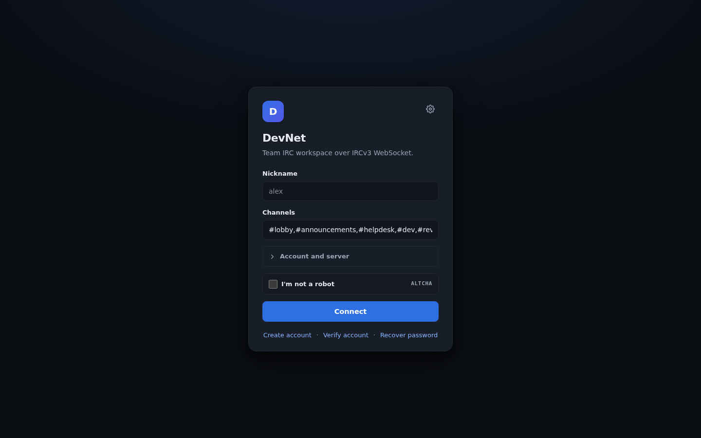 |
| Sign up | 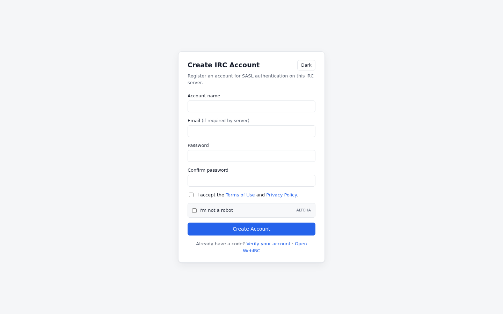 | 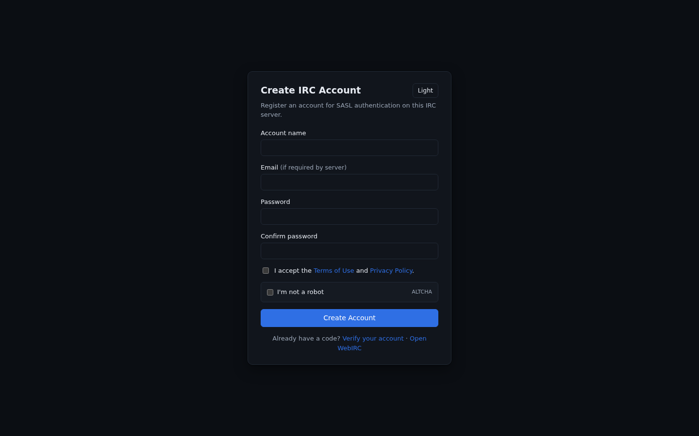 |
| Channel | 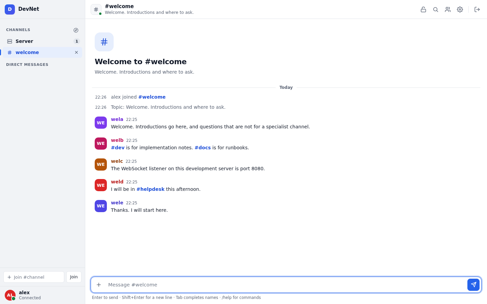 | 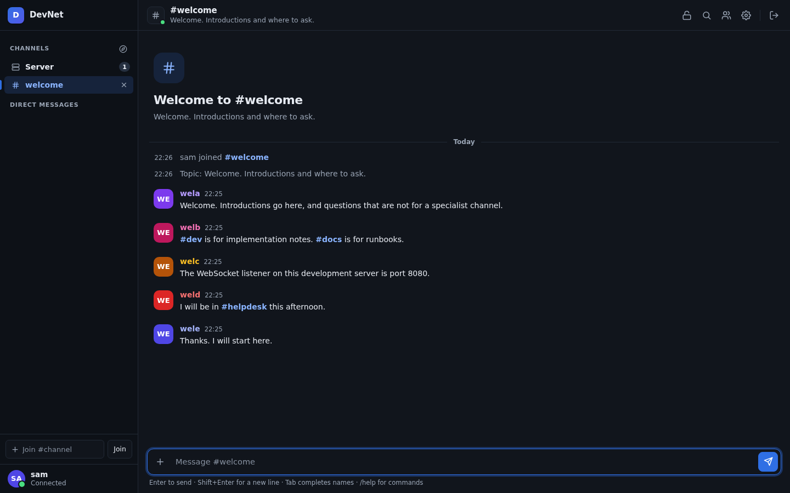 |
| Members | 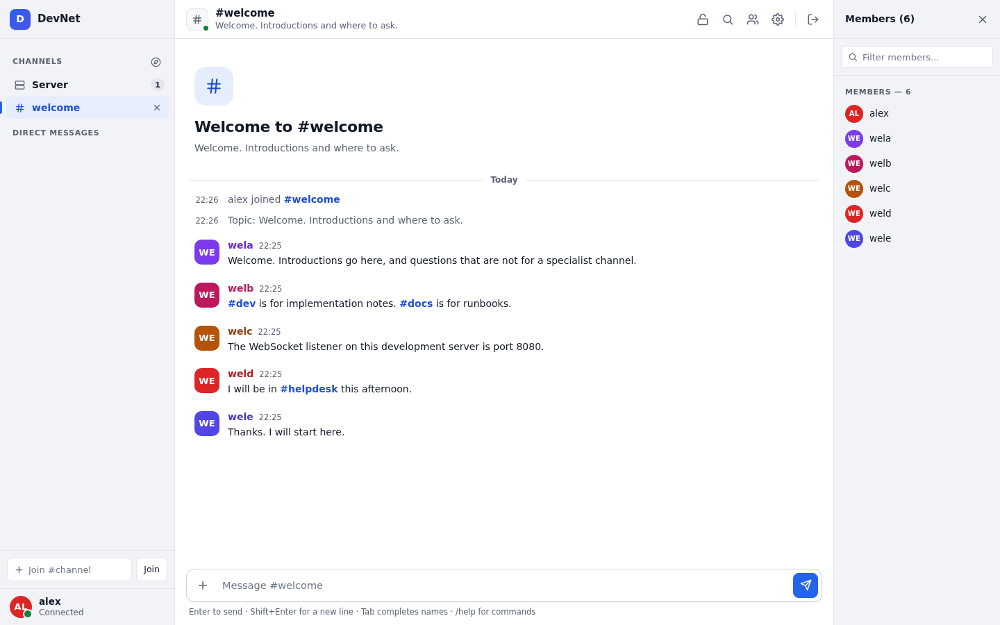 | 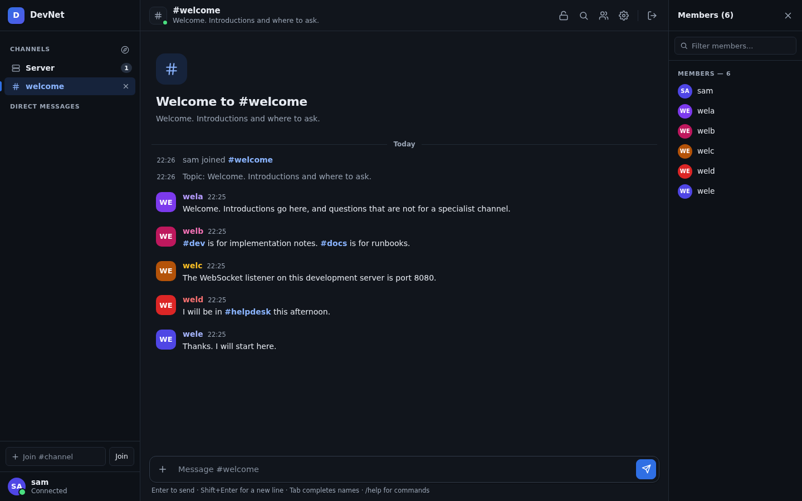 |
| Settings | 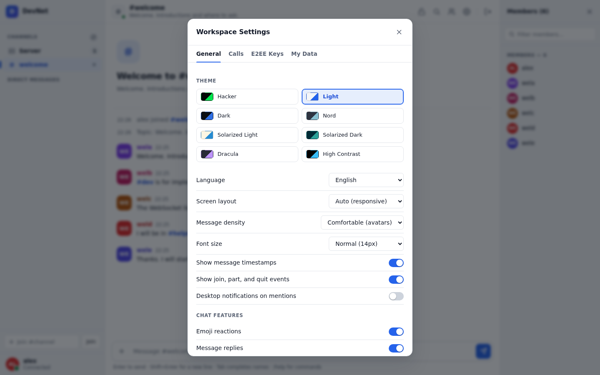 | 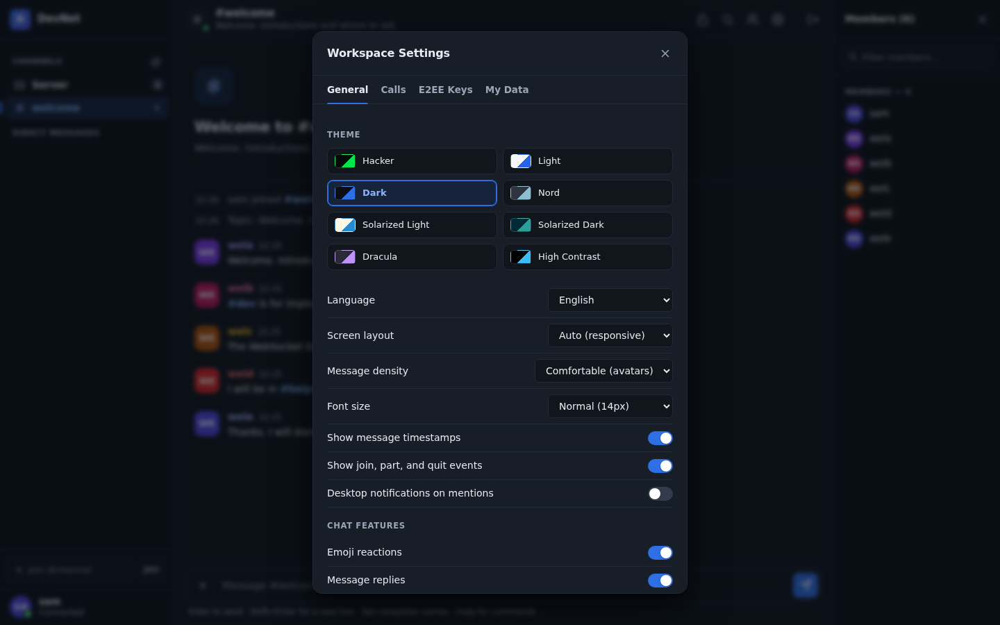 |
| Admin | 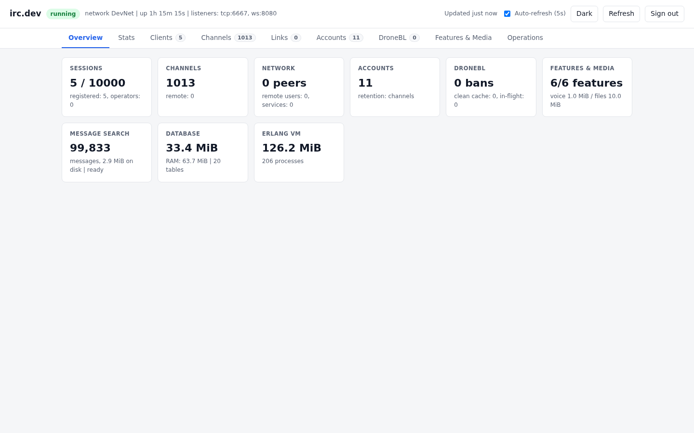 | 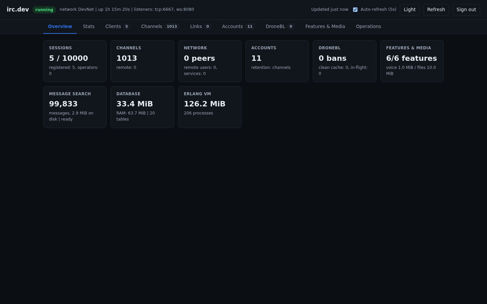 |

## Features

- Supervised TCP, TLS, and WebSocket listeners, client sessions, and server
  links.
- IRCv3: capability negotiation 302, message tags and server tags, batches,
  labeled responses, SASL and account registration, account and presence
  notifications, echo-message, chathistory, read markers, redaction,
  multiline, metadata, MONITOR, WHOX, channel rename, WEBIRC, STS, and more.
- Client registration, messaging, user queries, and common channel commands.
- Channel modes, access lists, invitations, safe channels, and anonymous
  channels.
- Server-to-server links, including bursts, multi-hop routing, invitations,
  and netsplit cleanup.
- Mnesia disk-copy tables, with persistence for WHOWAS history and safe-channel state.
- Optional one-to-one voice and video calls in WebIRC, relayed through rtpengine
  ([guide](docs/calls.md)).
- Optional full-text message search over stored history, through a Tantivy
  service, in IRC (`SEARCH`) and WebIRC ([guide](docs/search.md)).
- Optional AI assistant bots configured in the JSON file, answering in
  channels and private messages through any OpenAI-compatible API
  ([guide](docs/bots.md)).
- JSON logging by default, with text logging available in configuration. At
  `debug` or `trace`, each client and peer command is logged with the nick,
  command, and target. Message text, passwords, and channel keys are omitted.

## Quick start

Requirements: Erlang/OTP 29.x and Rebar3.

From the repository root:

```sh
rebar3 compile
rebar3 shell
```

The default configuration listens on `127.0.0.1:6667`. Connect with an IRC
client or a TCP client such as `nc`:

```sh
nc 127.0.0.1 6667
```

To start with another JSON configuration file, set `BRISKD_CONFIG`:

```sh
BRISKD_CONFIG=config/briskd.json rebar3 shell
```

For the Docker development environment, project commands, and CI, see
[Development](docs/development.md).

## Documentation

| Guide | Contents |
| --- | --- |
| [Configuration](docs/configuration.md) | Every JSON setting, TLS, retention, operators, and predefined channels |
| [IRC support](docs/irc-support.md) | Implemented commands, implementation policies, limits, and server links |
| [IRCv3](docs/ircv3.md) | Capabilities, tags, accounts, history, metadata, and WebSocket support |
| [WebIRC](docs/webirc.md) | Browser client: accounts, chat, files, calls, and encryption |
| [Message search](docs/search.md) | Optional Tantivy search over stored history: `SEARCH`, the briskd-search service, and WebIRC |
| [End-to-end encryption](docs/e2ee.md) | Optional blind broker for Double Ratchet / OMEMO clients: key directory and offline queue |
| [Deployment](docs/deployment.md) | Production image and Compose file, and graceful shutdown |
| [Development](docs/development.md) | Docker environment, `just` commands, CI, and building these docs |
| [Mnesia operations](docs/mnesia.md) | Persistence, backup, restore, and schema migration |
| [IRCv3 conformance](docs/conformance.md) | Running irctest against the server |
| [Benchmarks](bench/README.md) | Traffic and per-command benchmarks with server statistics |
| [Roadmap](ROADMAP.md) | Checked coverage of the RFCs and IRCv3 specifications |

API documentation, built from the module docs with ex_doc, is published at
<https://egorsmkv.github.io/briskd/> and includes these guides.

## Benchmarks

`bench/scripts/run.sh` measures a live development server, and `bench/scripts/prod.sh` measures
the production image. Both write a report under `bench/results/`. How to
run them is in [bench/README.md](bench/README.md).

## Protocol references

- [RFC 1459 — Internet Relay Chat Protocol](https://www.rfc-editor.org/rfc/rfc1459)
- [RFC 2810 — Internet Relay Chat: Architecture](https://www.rfc-editor.org/rfc/rfc2810)
- [RFC 2811 — Internet Relay Chat: Channel Management](https://www.rfc-editor.org/rfc/rfc2811)
- [RFC 2812 — Internet Relay Chat: Client Protocol](https://www.rfc-editor.org/rfc/rfc2812)
- [RFC 2813 — Internet Relay Chat: Server Protocol](https://www.rfc-editor.org/rfc/rfc2813)
- [RFC 7194 — Default Port for Internet Relay Chat](https://www.rfc-editor.org/rfc/rfc7194)
- [IRCv3 Capability Negotiation](https://ircv3.net/specs/extensions/capability-negotiation.html)
- [IRCv3 Message Tags](https://ircv3.net/specs/extensions/message-tags.html)
- [IRCv3 Labeled Responses](https://ircv3.net/specs/extensions/labeled-response.html)
- [IRCv3 specification index](https://ircv3.net/irc/)

## License

Licensed under the [Apache License 2.0](LICENSE.md).
